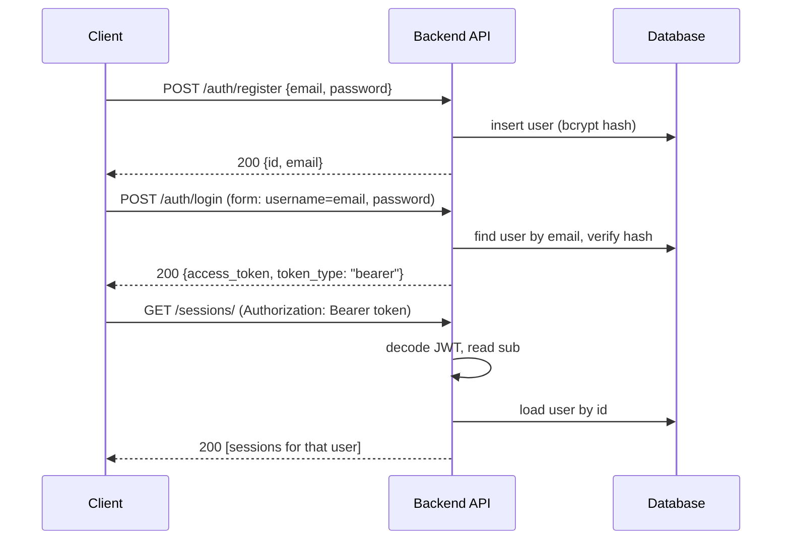
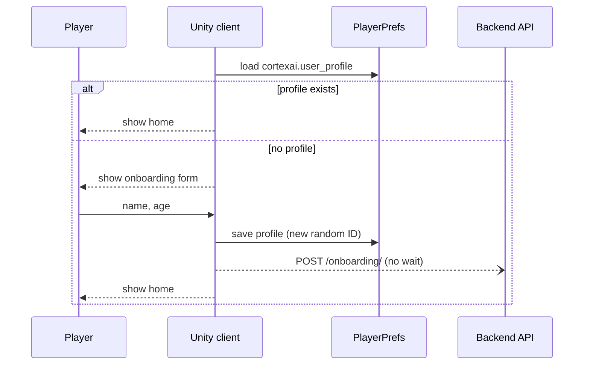

# Authentication Flow

Three identity mechanisms exist in the repo. They are not linked to each other.

| Mechanism | Used by | Credential | Code |
| --- | --- | --- | --- |
| Backend JWT | Dashboard | Email and password | `Backend/api/app/auth.py`, `routers/auth.py` |
| Onboarding profile | Unity client | Device-generated ID, no secret | `routers/onboarding.py`, `UnityClient/.../AuthManager.cs` |
| Firebase Auth | Sample scripts, `onUserCreate` | Firebase UID | `functions/src/index.ts`, `UnityClient/.../Network/AuthSample.cs` |

## Backend JWT

- Passwords: at least 6 characters, hashed with bcrypt through passlib.
- Login takes OAuth2 password form fields (`application/x-www-form-urlencoded`). The email goes in `username`.
- Token: HS256 by default, signed with `JWT_SECRET`. Claims are `sub` (the user ID as a string) and `exp` (60 minutes).
- No refresh tokens, logout, or revocation. A token is valid until it expires.
- No roles. Every signed-in user has the same access.

### Endpoint access

| Endpoint | Auth |
| --- | --- |
| `GET /health` | None |
| `POST /auth/register`, `POST /auth/login` | None |
| `GET /users/me`, `GET /users/` | Bearer token |
| `POST /sessions/`, `GET /sessions/` | Bearer token; scoped to the token's user |
| `POST /checkins/`, `GET /checkins/` | Bearer token; scoped to the token's user |
| `POST /ask/` | Bearer token |
| `POST /onboarding/`, `GET /onboarding/{client_user_id}` | None |
| AI services (`/analyze`, `/recommend`, `/reply`, `/ask`, `/health`) | None |

### Errors

| Status | When |
| --- | --- |
| 400 `Email already registered` | Register with an existing email |
| 401 `Incorrect email or password` | Login fails |
| 401 `Could not validate credentials` | Missing, expired, or invalid token, or the user no longer exists. Includes `WWW-Authenticate: Bearer`. |
| 404 `Onboarding profile not found` | Unknown `client_user_id` |
| 422 | Request body fails validation |

## Unity onboarding

"Sign in as existing user" only checks for a profile already saved on the same device. There is no password and no server lookup, so a profile cannot move between devices.

## Firebase Auth

`onUserCreate` runs when a Firebase Auth user is created and writes `users/{uid}` with `uid`, `email`, and `createdAt`. Firestore and Storage rules allow each user to access only paths under their own UID.

The Unity `AuthSample` script shows anonymous sign-in and sign-out, but no scene uses it, and the backend does not accept Firebase ID tokens.

## Not built yet

The planned design in [DataFlowDiagram.md](DataFlowDiagram.md) uses Azure AD B2C (OIDC) for identity. None of that exists in code. Also missing: roles, refresh tokens, and a single user ID shared by the backend, Unity, and Firebase.
