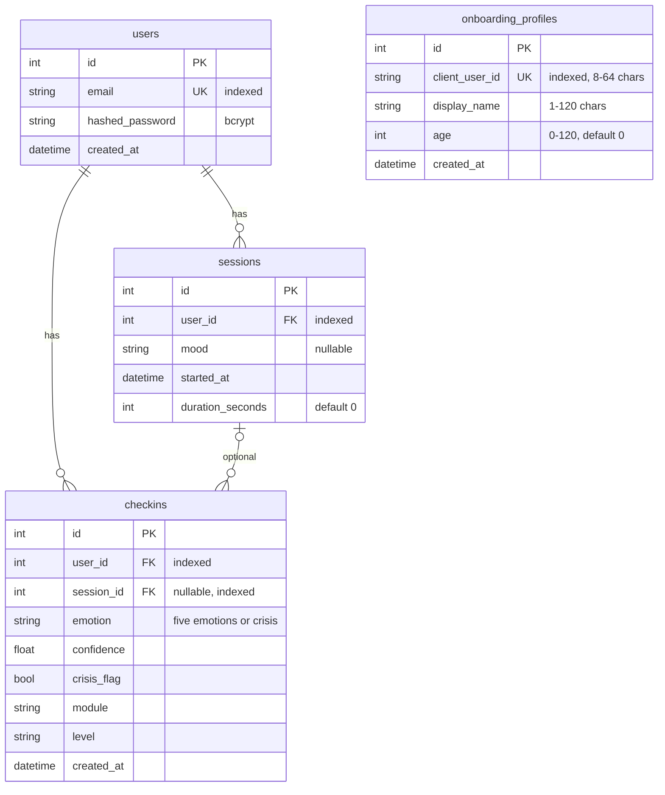

# Database Schema

Data lives in three places: the backend SQL database, Firebase (Firestore and Storage), and PlayerPrefs on the Unity device.

## Backend SQL

Defined in `Backend/api/app/models.py`. SQLite by default; any SQLAlchemy URL can be set with `DATABASE_URL`. Tables are created on startup with `Base.metadata.create_all`. There are no migrations.

- `onboarding_profiles` is not linked to `users`. Its key is the ID generated by the Unity client.
- `POST /onboarding/` creates a row, or updates `display_name` and `age` if the `client_user_id` already exists.
- Timestamps are set by the app with `datetime.utcnow` and stored without a timezone.
- `sessions.mood` is free text. The AI services use `joy`, `sadness`, `anger`, `fear`, and `neutral`, but nothing enforces that here. A check-in with a `session_id` overwrites that session's mood. Crisis check-ins store `crisis` (confidence `0.0`) in both places, never the classifier's label.
- `checkins` stores the analysis result and the recommended module, never the user's text. Its `module` column is the history the recommender uses.
- `checkins` is a new table, so `create_all` adds it to an existing dev database without changes to other tables.

## Firestore

| Path | Written by | Fields | Access |
| --- | --- | --- | --- |
| `users/{uid}` and subcollections | `onUserCreate`, the client | `uid`, `email`, `createdAt` (server timestamp), plus anything the client adds | Only the signed-in user with that UID |
| `public/**` | Any signed-in user | Not defined | Read by anyone |

Everything else is denied.

## Storage

| Path | Access |
| --- | --- |
| `userContent/{uid}/**` | Read and write by the signed-in user with that UID |
| `public/**` | Read by anyone; write by any signed-in user |

## Unity PlayerPrefs

| Key | Value |
| --- | --- |
| `cortexai.user_profile` | JSON from `UserProfile`: `UserId`, `DisplayName`, `Age` |
| `cortexai.api_base` | Optional backend URL override |

`UserProfile.CreatedAtUtc` is a `DateTime`, which Unity's `JsonUtility` does not serialize, so it is not saved.

## Personal data

Email, display name, age, mood, and check-in results (emotion and crisis flag) are personal data. Mood and the crisis flag can count as health-related. Classification targets are in [DataClassificationTable.md](DataClassificationTable.md).
