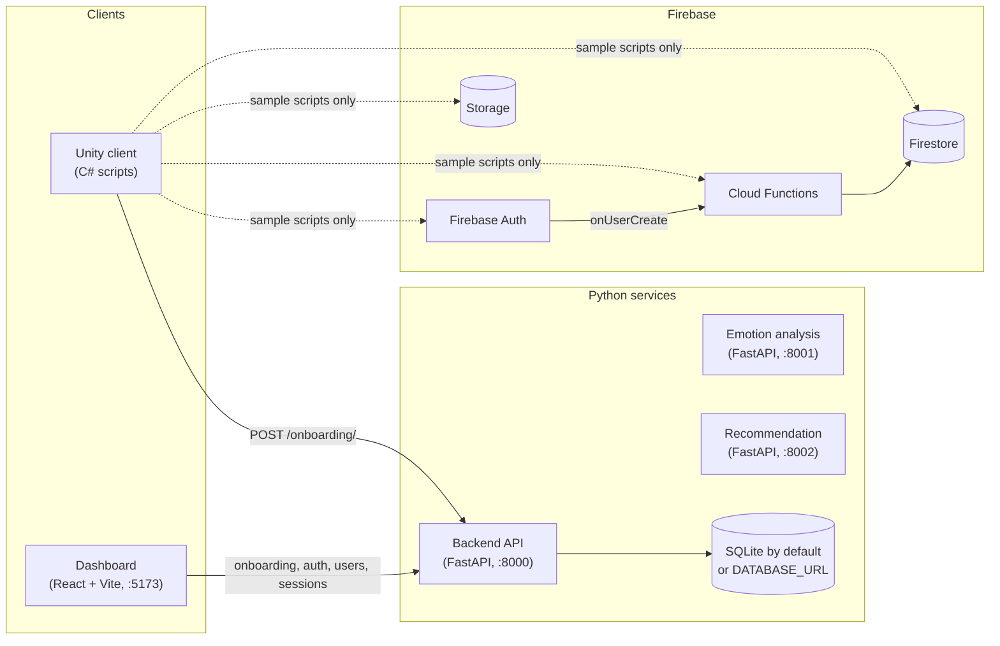

# System Architecture

This describes what is in the repo today. The planned Azure deployment is in [DataFlowDiagram.md](DataFlowDiagram.md) and is not built yet.

## Components

Solid arrows are calls the code makes today. Dotted arrows are Firebase sample scripts that nothing calls yet. The two AI services have no callers.

| Component | Path | What it does now |
| --- | --- | --- |
| Backend API | `Backend/api` | Email/password sign-up and login (JWT), session records, onboarding profiles. SQLAlchemy; tables created on startup. |
| Emotion analysis | `AIEngine/emotion_analysis` | `POST /analyze` matches keywords to one of `joy`, `sadness`, `anger`, `fear`, `neutral`. |
| Recommendation | `AIEngine/recommendation` | `POST /recommend` maps a mood to a fixed module and level. |
| Dashboard | `Analytics/dashboard` | Four pages (onboarding, login, users, sessions) that call the backend. Base URL from `VITE_API_BASE`. |
| Cloud Functions | `functions` | `helloWorld` HTTP function, `onUserCreate` (writes `users/{uid}`), `sanitizeUserData` (Firestore trigger). |
| Firestore and Storage rules | `firestore.rules`, `storage.rules` | Users can read and write only their own data; `public/` is world-readable. |
| Unity client | `UnityClient/Assets/Scripts` | Local onboarding and sign-in, session timer, onboarding POST to the backend, Firebase samples. |

## Request flow

The only end-to-end path today is Unity onboarding:

1. The Unity client creates a profile with a random 32-character ID and saves it in PlayerPrefs.
2. It posts the profile to `POST /onboarding/` without waiting for the result.
3. The backend creates or updates the row in `onboarding_profiles`.

Unity sessions are timed on the device only. They are not sent to `POST /sessions/`.

## Identity

Three separate identities exist, and none are linked:

- **Backend user**: email and password, JWT access token. Used by the dashboard.
- **Onboarding profile**: device-generated `client_user_id`. Used by Unity; the endpoints are unauthenticated.
- **Firebase user**: Firebase Auth UID. Only the sample scripts and `onUserCreate` use it.

Details are in [AuthenticationFlow.md](AuthenticationFlow.md). Tables and documents are in [DatabaseSchema.md](DatabaseSchema.md).

## Build and deploy

| Workflow | Trigger | Does |
| --- | --- | --- |
| `ci.yml` | Push, PR | Installs each Python service, imports it, starts it, and checks `/health`. Builds the dashboard. Does not run `pytest`. |
| `ghcr.yml` | Push to `main` | Builds and pushes the backend, emotion, and recommendation images to GHCR. |
| `pages.yml` | Push to `main` | Builds the dashboard with `VITE_BASE` and deploys it to GitHub Pages. |

All three Python Dockerfiles use `python:3.11-slim`. Firebase deploys are manual (`npm run deploy` in `functions/`).

## Known gaps

- The AI services are placeholders and nothing calls them.
- The onboarding endpoints need no auth, so anyone can read or overwrite a profile if they know its ID.
- `GET /users/` returns every user to any signed-in user.
- CORS allows all origins with credentials on every Python service.
- `JWT_SECRET` falls back to a hardcoded dev value.
- Login always issues 60-minute tokens; `ACCESS_TOKEN_EXPIRE_MINUTES` is read but not used there.
- No database migrations; schema changes need `create_all` on a fresh database.
- `sanitizeUserData` writes back to the document that triggers it, so it re-triggers itself. It also writes with `merge: true`, which keeps the existing `isAdmin` field instead of removing it.
- `UnityClient/` has no `ProjectSettings/`, scenes, or `.meta` files, and the Firebase Unity SDK is not included.
- Compiled `.pyc` files and `functions/lib/` build output are committed.
