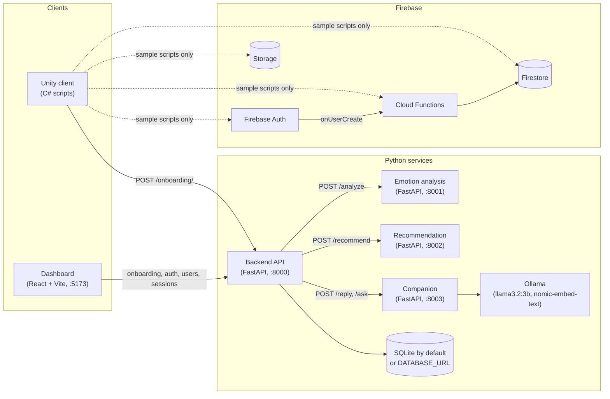
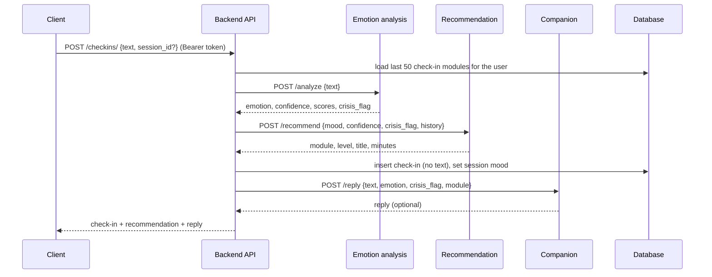

# System Architecture

This describes what is in the repo today. The planned Azure deployment is in [DataFlowDiagram.md](DataFlowDiagram.md) and is not built yet.

## Components

Solid arrows are calls the code makes today. Dotted arrows are Firebase sample scripts that nothing calls yet. No client calls `/checkins/` or `/ask/` yet.

| Component | Path | What it does now |
| --- | --- | --- |
| Backend API | `Backend/api` | Email/password sign-up and login (JWT), session records, onboarding profiles, check-ins. SQLAlchemy; tables created on startup. |
| Emotion analysis | `AIEngine/emotion_analysis` | `POST /analyze` runs a local GoEmotions RoBERTa model and groups its 28 labels into `joy`, `sadness`, `anger`, `fear`, `neutral`. Falls back to a keyword classifier if the model can't load. Adds a keyword-based `crisis_flag`. |
| Recommendation | `AIEngine/recommendation` | `POST /recommend` picks from a 9-module catalog by mood, rotates through modules using history, and raises the level with repeat use. A crisis flag always returns `crisis_support`. |
| Companion | `AIEngine/companion` | `POST /reply` writes a short supportive reply with a local Ollama model. `POST /ask` answers from reviewed question-bank entries using embedding search. Crisis inputs get fixed text, and output containing contact details is replaced. |
| Training | `AIEngine/training` | Offline scripts: export GoEmotions as a 5-emotion dataset, fine-tune the classifier, and evaluate any model through the serving code. |
| Dashboard | `Analytics/dashboard` | Four pages (onboarding, login, users, sessions) that call the backend. Base URL from `VITE_API_BASE`. |
| Cloud Functions | `functions` | `helloWorld` HTTP function, `onUserCreate` (writes `users/{uid}`), `sanitizeUserData` (removes `isAdmin` from `users/{uid}` if one gets there). |
| Firestore and Storage rules | `firestore.rules`, `storage.rules` | Users can read and write only their own data and can't set `isAdmin` on their user document; `public/` is world-readable. |
| Unity client | `UnityClient/Assets/Scripts` | Local onboarding and sign-in, session timer, onboarding POST to the backend, Firebase samples. |

## Request flows

### Check-in

The text goes only to the emotion and companion services on your own infrastructure and is never written to the database. If emotion or recommendation fails, the backend returns 503 and saves nothing. If the companion fails, the check-in is saved with `reply: null`.

### Ask

`POST /ask/` screens the question with the emotion service's crisis check, then sends it to the companion. The companion embeds it, finds reviewed entries with cosine similarity of at least 0.58, and asks the model to answer only from those. With no match, it returns a fixed "no answer" message without calling the model. Nothing is stored.

### Unity onboarding

1. The Unity client creates a profile with a random 32-character ID and saves it in PlayerPrefs.
2. It posts the profile to `POST /onboarding/` without waiting for the result.
3. The backend creates or updates the row in `onboarding_profiles`.

Unity sessions are timed on the device only. They are not sent to `POST /sessions/`.

## Identity

Three separate identities exist, and none are linked:

- **Backend user**: email and password, JWT access token. Used by the dashboard.
- **Onboarding profile**: device-generated `client_user_id`. Used by Unity; the endpoints are unauthenticated.
- **Firebase user**: Firebase Auth UID. Only the sample scripts and `onUserCreate` use it.

Details are in [AuthenticationFlow.md](AuthenticationFlow.md). Tables and documents are in [DatabaseSchema.md](DatabaseSchema.md).

## Build and deploy

| Workflow | Trigger | Does |
| --- | --- | --- |
| `ci.yml` | Push, PR | Installs each Python service, runs `pytest`, imports it, starts it, and checks `/health`. Builds the dashboard. The emotion job uses the keyword classifier, not the model. |
| `ghcr.yml` | Push to `main` | Builds and pushes the backend, emotion, and recommendation images to GHCR. |
| `pages.yml` | Push to `main` | Builds the dashboard with `VITE_BASE` and deploys it to GitHub Pages. |

All three Python Dockerfiles use `python:3.11-slim`. The emotion image installs CPU-only PyTorch and downloads the pinned model revision at build time, then sets `HF_HUB_OFFLINE=1`. Firebase deploys are manual (`npm run deploy` in `functions/`).

## Known gaps

- The emotion model is English-only and trained on Reddit comments; it hasn't been evaluated on this app's users.
- The crisis flag is a short keyword list. It misses indirect phrasing, still flags negations ("I'm not suicidal"), and is not a clinical risk assessment.
- Level progression counts how often a module was recommended, not whether the user completed it.
- No client calls `/checkins/` yet, and the Unity client has no content for the new catalog modules.
- The AI services have no authentication, so they must stay on a private network.
- Every question-bank entry is a draft until reviewed, so `/ask/` gives no real answers in production yet.
- Companion replies are generated and not clinically reviewed. The contact-details filter is a regex and won't catch every format.
- `llama3.2:3b` on an 8 GB M1 takes about 5–10 s per reply or answer.
- Onboarding profiles created before device secrets existed are claimed by the first secret that updates them.
- `ADMIN_EMAILS` is a stopgap for real roles.
- There is no rate limiting on login, registration, or the AI endpoints.
- No database migrations; schema changes need `create_all` on a fresh database.
- `UnityClient/` has no `ProjectSettings/`, scenes, or `.meta` files, and the Firebase Unity SDK is not included.
- Firebase functions and rules have no automated tests in CI.
